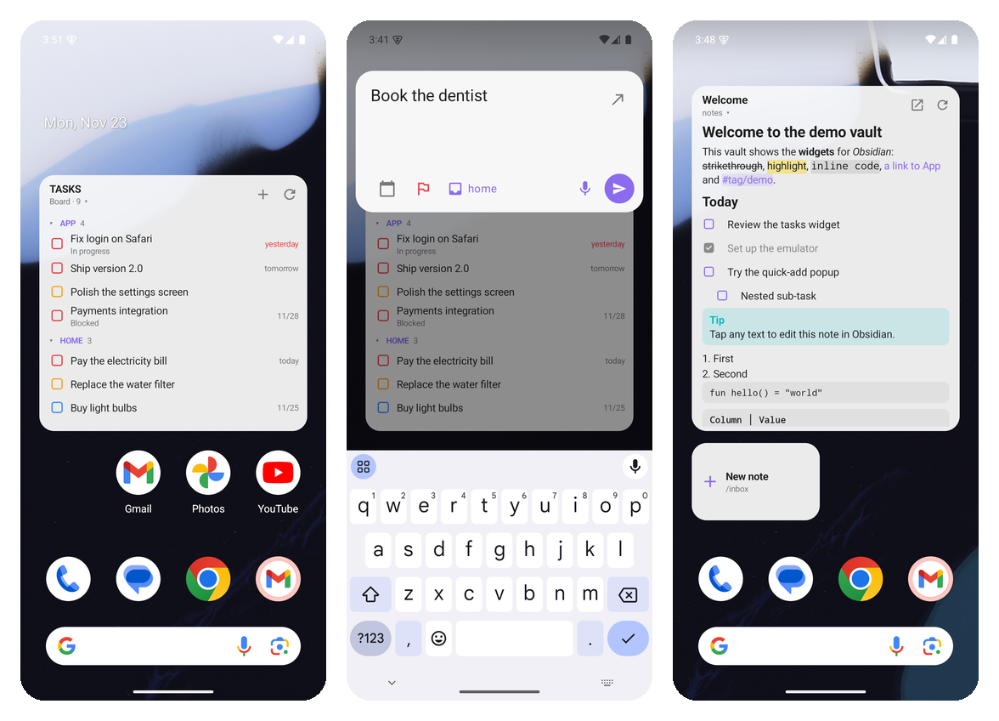
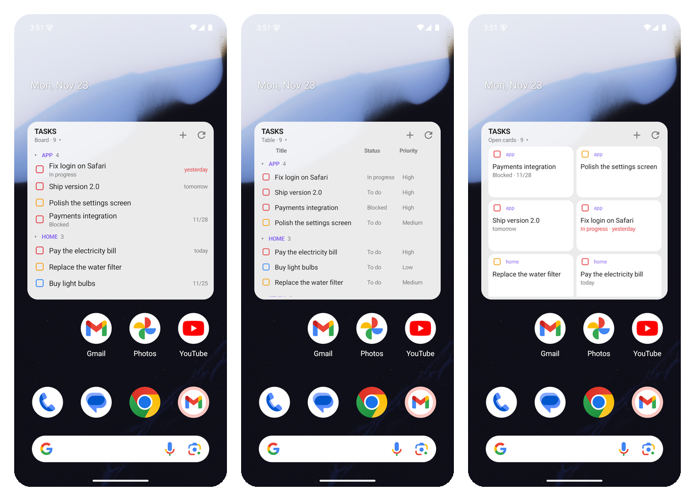
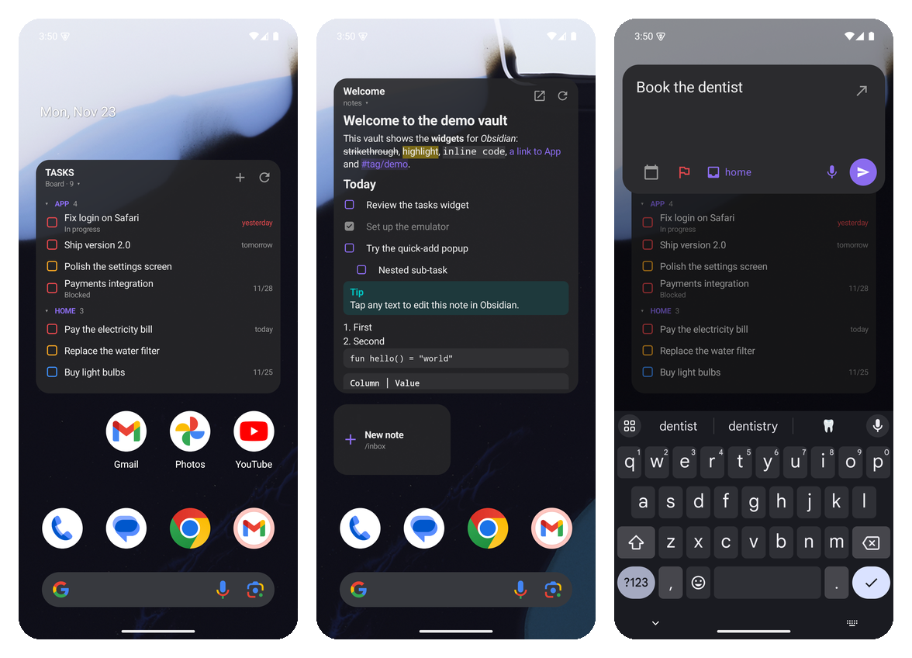

# Widgets for Obsidian

Android home-screen widgets for your [Obsidian](https://obsidian.md) vault: your task bases as a
TickTick-style checklist, any note rendered like Obsidian, and quick capture without opening the app.



## Download

**[⬇ Download the latest APK](https://github.com/j4marcos/widgets-for-obsidian-mobile/releases/latest/download/widgets-for-obsidian.apk)** · Android 8.0+

New to sideloading? Follow the **[installation guide](docs/INSTALL.md)**.

## Widgets

- **Tasks (base)**: shows an Obsidian [Bases](https://help.obsidian.md/bases) file (`.base`) as a checklist.
  Sections are grouped by project and can be collapsed. Checkboxes take the priority color, due dates
  are shown on the right, and completed tasks can be hidden. Tap a checkbox to complete the task
  (it writes `status: done` to the note). Tap the title to switch views. Tap **+** to add a task.
- **Note**: renders any note with headings, formatting, links, tags, callouts, code and tables.
  Checkboxes can be ticked from the home screen, and tapping the text opens the note in Obsidian.
  It can also follow whatever note is open in Obsidian.
- **New note**: one tap opens a quick-capture card that writes a note to `inbox/`.

Widgets follow your Obsidian theme (light, dark or system, plus the accent color) and refresh by
themselves when files in the vault change, even when the app is closed.





## Build from source

Requires JDK 17+ and the Android SDK (platform 36).

```bash
./gradlew assembleDebug
```

The APK is written to `app/build/outputs/apk/debug/app-debug.apk`.

---

Not affiliated with or endorsed by Obsidian.
